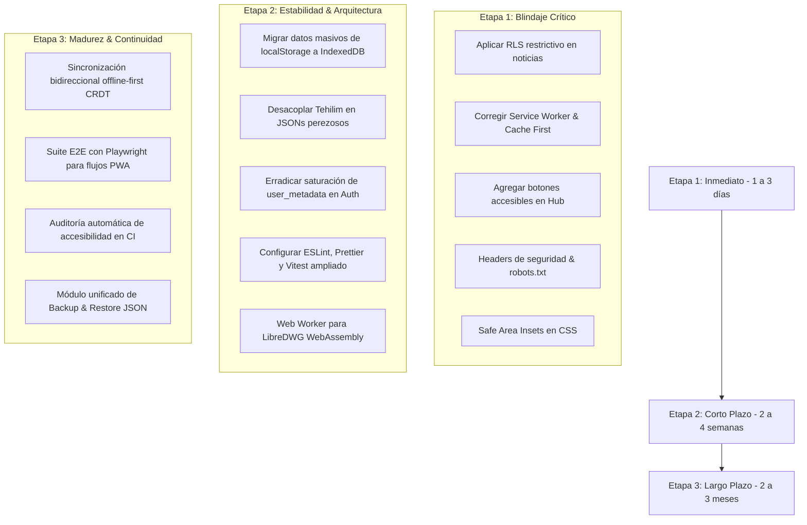

# Auditoría Técnica Senior: Personal Tools Suite (PWA)

**Fecha:** 20 de Octubre de 2026  
**Auditor:** Auditor Técnico Senior (Google Antigravity)  
**Objetivo:** Evaluación integral de seguridad, PWA, rendimiento, arquitectura, persistencia, accesibilidad y calidad de código.  
**Estado del Repositorio:** `main` (commit limpio, rama sincronizada con `origin/main`).

---

## 1. Resumen Ejecutivo

Personal Tools es una suite modular PWA rica y funcional construida sobre **React 19, Vite, TailwindCSS y Supabase**, orientada a la productividad personal, finanzas, bienestar y estudio. Su arquitectura desacoplada mediante un registro dinámico (`moduleRegistry.ts`) y carga perezosa (`React.lazy`) representa una base moderna y extensible. No obstante, la auditoría identificó **vulnerabilidades críticas en las políticas RLS de Supabase** (que permiten escritura anónima sin autenticación en noticias), **exposición de claves de API en el historial y frontend**, y un **anti-patrón de saturación del token JWT** al usar `auth.users.raw_user_meta_data` como base de datos operativa. Además, la **accesibilidad por teclado está rota en el Launcher** por el uso de `<div>` no interactivos, y la persistencia depende de forma frágil de `localStorage` con riesgo inminente de `QuotaExceededError`. La aplicación cuenta con gran potencial técnico pero requiere endurecimiento urgente en seguridad y persistencia antes de escalar.

### Puntuación de Madurez Técnica (0 a 10)

| Área Auditada | Calificación | Estado General |
| :--- | :---: | :--- |
| **1. Seguridad** | **4.0 / 10** | ⚠️ Crítico: RLS abierta a anónimos en noticias; API key expuesta en URL y git; falta CSP. |
| **2. PWA & Offline** | **6.5 / 10** | ⚠️ Bueno en instalabilidad pero Service Worker usa Network First para assets inmutables. |
| **3. Rendimiento** | **5.5 / 10** | ⚠️ Chunks de hasta 826 kB (Tehilim) y WebAssembly de 9.5 MB ejecutándose en Main Thread. |
| **4. Calidad y Arquitectura** | **6.0 / 10** | ⚠️ Modularidad limpia (OCP), pero saturación de JWT (`user_metadata`) y sin linter. |
| **5. Datos y Persistencia** | **4.5 / 10** | ⚠️ Riesgo de pérdida: 100% dependiente de localStorage; IndexedDB ausente; migraciones divididas. |
| **6. Accesibilidad (WCAG 2.2)** | **4.0 / 10** | ❌ Falla: Launchers inaccesibles por teclado (divs sin role ni tabIndex); contrastes bajos. |
| **7. UX/UI y Responsive** | **7.0 / 10** | ⚠️ Gran diseño visual y dark mode, pero falta soporte Safe Area para iOS en PWA. |
| **8. SEO y Metadatos** | **5.0 / 10** | ⚠️ Sin `robots.txt` ni meta `noindex` en suite privada. |
| **9. Privacidad y Legal** | **4.0 / 10** | ⚠️ Datos personales sensibles (salud, emociones, patrimonio) sin política ni aviso legal. |
| **10. Testing y CI/CD** | **4.5 / 10** | ⚠️ Solo 4 suites de prueba (< 5% cobertura); CI no audita seguridad ni backend. |
| **11. Dependencias** | **6.0 / 10** | ⚠️ 8 vulnerabilidades en npm audit; sin fijación de versiones Node en engines. |
| **12. Documentación** | **5.0 / 10** | ⚠️ README obsoleto (omite 11 módulos); falta archivo de licencia formal (LICENSE). |
| **13. Compatibilidad** | **7.5 / 10** | ✅ Buen soporte en navegadores modernos; petición HTTP insegura en worker arXiv. |
| **PROMEDIO GLOBAL** | **5.3 / 10** | **Nivel: Requiere Intervención de Endurecimiento y Estabilización.** |

---

## 2. Matriz General de Hallazgos

| ID | Área | Severidad | Archivo:Línea | Descripción Breve | Esfuerzo |
| :--- | :--- | :---: | :--- | :--- | :---: |
| **SEC-01** | Seguridad | **CRÍTICO** | [`backend/supabase/news_schema.sql:66-70`](file:///c:/Users/marce/Documents/APP/backend/supabase/news_schema.sql#L66-L70) | RLS abierta: Permite `INSERT` y `UPDATE` en noticias a usuarios anónimos (`anon`) con `CHECK (true)`. | **S** |
| **SEC-02** | Seguridad | **ALTO** | [`web/src/lib/pantryAiEngine.ts:343`](file:///c:/Users/marce/Documents/APP/web/src/lib/pantryAiEngine.ts#L343) | Gemini API Key transmitida como parámetro en URL query string (`?key=...`) y expuesta en bundle cliente. | **S** |
| **SEC-03** | Seguridad | **ALTO** | [`web/src/lib/supabase.ts:4-6`](file:///c:/Users/marce/Documents/APP/web/src/lib/supabase.ts#L4-L6) | URL de Supabase y clave anónima real cableadas en duro como valores por defecto en código fuente. | **S** |
| **SEC-04** | Seguridad | **MEDIO** | [`web/package-lock.json`](file:///c:/Users/marce/Documents/APP/web/package-lock.json) | 8 vulnerabilidades detectadas por `npm audit` (6 altas en `braces`, `source-map-js`, 2 moderadas). | **S** |
| **SEC-05** | Seguridad | **MEDIO** | [`vercel.json:1-32`](file:///c:/Users/marce/Documents/APP/vercel.json#L1-L32) | Ausencia total de cabeceras de seguridad HTTP (CSP, HSTS, X-Frame-Options, Permissions-Policy). | **S** |
| **SEC-06** | Seguridad | **BAJO** | [`SingleArticleCard.tsx:23,48`](file:///c:/Users/marce/Documents/APP/web/src/pages/news/components/SingleArticleCard.tsx#L23) | Enlaces externos con `target="_blank"` omiten `rel="noopener"`. | **S** |
| **A11Y-01**| Accesibilidad | **CRÍTICO** | [`ToolHub.tsx:240,322`](file:///c:/Users/marce/Documents/APP/web/src/components/ToolHub.tsx#L240) | Tarjetas del Hub son `<div>` sin semántica, sin `tabIndex` ni `onKeyDown`. Navegación por teclado rota. | **M** |
| **A11Y-02**| Accesibilidad | **MEDIO** | [`ToolHub.tsx:386`](file:///c:/Users/marce/Documents/APP/web/src/components/ToolHub.tsx#L386) | Ratios de contraste insuficientes en textos secundarios (`text-slate-400` en modo claro ~2.9:1). | **S** |
| **A11Y-03**| Accesibilidad | **MEDIO** | [`web/src/index.css:1-59`](file:///c:/Users/marce/Documents/APP/web/src/index.css#L1-L59) | Sin soporte para `prefers-reduced-motion`. Animaciones y transiciones forzadas. | **S** |
| **A11Y-04**| Accesibilidad | **BAJO** | [`ToolHub.tsx:250-262`](file:///c:/Users/marce/Documents/APP/web/src/components/ToolHub.tsx#L250-L262) | Objetivos táctiles (Touch Targets) de botones secundarios inferiores a 24x24 px (ej. botón pin 22px). | **S** |
| **PWA-01** | PWA | **ALTO** | [`web/public/sw.js:84-101`](file:///c:/Users/marce/Documents/APP/web/public/sw.js#L84-L101) | Service Worker aplica `Network First` a assets inmutables de Vite (`/assets/*`), degradando rendimiento offline. | **S** |
| **PWA-02** | PWA | **ALTO** | [`web/public/sw.js:98,114`](file:///c:/Users/marce/Documents/APP/web/public/sw.js#L98) | Manejadores de `fetch` retornan `undefined` ante fallas de caché, disparando pantallas de error del navegador. | **S** |
| **PWA-03** | PWA | **MEDIO** | [`web/public/sw.js:2-14`](file:///c:/Users/marce/Documents/APP/web/public/sw.js#L2-L14) | Precaching manual insuficiente; no incluye los chunks JS de la aplicación ni fuentes web. | **M** |
| **PWA-04** | PWA | **MEDIO** | [`manifest.webmanifest:1-50`](file:///c:/Users/marce/Documents/APP/web/public/manifest.webmanifest#L1-L50) | Manifest incompleto: carece de `shortcuts` para módulos clave y `screenshots` para el instalador enriquecido. | **S** |
| **PERF-01**| Rendimiento | **ALTO** | [`tehilimData.ts:1`](file:///c:/Users/marce/Documents/APP/packages/shared/src/data/tehilimData.ts#L1) | Chunk monolítico de Tehilim de 826 kB JS por incrustación en código en lugar de carga fraccionada JSON. | **M** |
| **PERF-02**| Rendimiento | **ALTO** | [`cadParser.ts:957`](file:///c:/Users/marce/Documents/APP/web/src/lib/cadParser.ts#L957) | LibreDWG WebAssembly (9.5 MB) se instancia y ejecuta en el Main Thread congelando la UI durante parseo. | **L** |
| **PERF-03**| Rendimiento | **MEDIO** | [`moduleRegistry.ts:24`](file:///c:/Users/marce/Documents/APP/web/src/modules/moduleRegistry.ts#L24) | Bundle inicial del Hub supera los 750 kB de JavaScript (frente a la meta anunciada de < 90 kB). | **M** |
| **PERF-04**| Rendimiento | **MEDIO** | [`web/vite.config.ts:14`](file:///c:/Users/marce/Documents/APP/web/vite.config.ts#L14) | `chunkSizeWarningLimit: 900` oculta chunks sobredimensionados en lugar de resolver la división de código. | **S** |
| **ARC-01** | Arquitectura| **ALTO** | [`PgnPrepModule.tsx:76`](file:///c:/Users/marce/Documents/APP/web/src/pages/pgn/PgnPrepModule.tsx#L76) | Saturación de JWT: Uso de `auth.users.raw_user_meta_data` como BD relacional provoca error HTTP 431 a futuro. | **M** |
| **ARC-02** | Calidad | **MEDIO** | [`web/`](file:///c:/Users/marce/Documents/APP/web) | Repositorio sin linter ni formateador configurado (cero ESLint, Prettier o Biome). | **S** |
| **ARC-03** | Calidad | **MEDIO** | [`parashaService.ts:649`](file:///c:/Users/marce/Documents/APP/web/src/lib/parashaService.ts#L649) | Más de 25 bloques `catch {}` vacíos que silencian fallos de red y errores de parseo sin feedback al usuario. | **M** |
| **DAT-01** | Persistencia | **ALTO** | [`PantryModule.tsx:207`](file:///c:/Users/marce/Documents/APP/web/src/pages/pantry/PantryModule.tsx#L207) | Persistencia masiva en `localStorage` (sin IndexedDB) expuesta a bloqueo del Main Thread y límite de 5 MB. | **L** |
| **DAT-02** | Persistencia | **ALTO** | [`supabase/migrations/`](file:///c:/Users/marce/Documents/APP/supabase/migrations) | Migraciones desincronizadas: esquemas de noticias, patrimonio y pirkei avot ausentes en `supabase/migrations/`. | **S** |
| **DAT-03** | Persistencia | **MEDIO** | [`App.tsx:35`](file:///c:/Users/marce/Documents/APP/web/src/App.tsx#L35) | Ausencia de backup y exportación/importación unificada de datos del usuario entre dispositivos. | **M** |
| **UX-01**  | UX/UI | **ALTO** | [`index.html:5`](file:///c:/Users/marce/Documents/APP/web/index.html#L5) | Sin soporte de `safe-area-inset` en iOS: botones y barras se solapan con el Home Indicator y Dynamic Island. | **S** |
| **UX-02**  | UX/UI | **MEDIO** | [`HebrewSrsModule.tsx:75`](file:///c:/Users/marce/Documents/APP/web/src/pages/hebrew_srs/HebrewSrsModule.tsx#L75) | Ausencia de Skeletons durante transiciones asíncronas genera parpadeos perceptibles. | **S** |
| **SEO-01** | SEO | **MEDIO** | [`web/public/robots.txt`](file:///c:/Users/marce/Documents/APP/web/public/robots.txt) | Aplicación privada sin `robots.txt` ni meta tag `noindex, nofollow`, permitiendo indexación en buscadores. | **S** |
| **PRIV-01**| Privacidad | **MEDIO** | [`LoginPage.tsx:75`](file:///c:/Users/marce/Documents/APP/web/src/pages/LoginPage.tsx#L75) | Procesamiento de datos personales sensibles (emociones, finanzas) sin consentimiento ni aviso de privacidad. | **S** |
| **TEST-01**| Testing | **ALTO** | [`web/src/lib/__tests__`](file:///c:/Users/marce/Documents/APP/web/src/lib/__tests__) | Cobertura menor al 5%: 9 de 13 módulos y flujos críticos de auth/sync carecen de pruebas automatizadas. | **M** |
| **TEST-02**| CI/CD | **MEDIO** | [`.github/workflows/ci.yml:10-38`](file:///c:/Users/marce/Documents/APP/.github/workflows/ci.yml#L10-L38) | Pipeline CI incompleto: no incluye chequeos de linting, `npm audit` ni validaciones de backend. | **S** |
| **DEP-01** | Dependencias| **MEDIO** | [`web/package.json:1-32`](file:///c:/Users/marce/Documents/APP/web/package.json#L1-L32) | Ausencia de campo `engines` para fijar versiones de Node.js y npm compatibles. | **S** |
| **DEP-02** | Dependencias| **BAJO** | [`backend/`](file:///c:/Users/marce/Documents/APP/backend) | Scripts Python de backend sin `requirements.txt` que documente dependencias (`pg8000`). | **S** |
| **DOC-01** | Documentación| **MEDIO** | [`README.md:1-44`](file:///c:/Users/marce/Documents/APP/README.md#L1-L44) | README describe únicamente Finanzas y omite los otros 11 módulos activos de la suite. | **S** |
| **DOC-02** | Documentación| **BAJO** | [Raíz del proyecto](file:///c:/Users/marce/Documents/APP) | Ausencia de archivo de licencia legal (`LICENSE`). | **S** |
| **COMP-01**| Compatibilidad| **MEDIO**| [`ingest_news.py:76`](file:///c:/Users/marce/Documents/APP/backend/worker/ingest_news.py#L76) | Consumo de API de arXiv mediante protocolo inseguro no cifrado `http://` en vez de `https://`. | **S** |

---

## 3. Top 10 Acciones Prioritarias

1. **Cerrar de inmediato la política RLS abierta en `news_articles` y `news_clusters` (SEC-01):**  
   *Impacto: Crítico | Esfuerzo: Bajo (15 min)*  
   Eliminar el permiso de escritura anónima a internet; restringir mutaciones exclusivamente a `service_role`.
2. **Restaurar accesibilidad por teclado y semántica interactiva en el Hub (A11Y-01):**  
   *Impacto: Crítico | Esfuerzo: Medio (45 min)*  
   Convertir las tarjetas de módulos en `<button>` con `tabIndex={0}` y eventos `Enter`/`Espacio`, permitiendo navegación accesible.
3. **Erradicar el anti-patrón de saturación de JWT en `auth.updateUser` (ARC-01):**  
   *Impacto: Alto | Esfuerzo: Medio (2 horas)*  
   Dejar de almacenar arrays de avance de PGN, Parashá y uso de módulos en `user_metadata` para evitar fallos de encabezado HTTP 431.
4. **Optimizar estrategia de caché en Service Worker a Cache First para assets inmutables (PWA-01, PWA-02):**  
   *Impacto: Alto | Esfuerzo: Bajo (20 min)*  
   Acelerar drásticamente la carga offline y evitar pantallas de error blancas por promesas resueltas a `undefined`.
5. **Configurar cabeceras HTTP de seguridad y CSP en `vercel.json` (SEC-05):**  
   *Impacto: Alto | Esfuerzo: Bajo (20 min)*  
   Prevenir Clickjacking, forzar HTTPS y restringir orígenes de scripts y conexiones externas.
6. **Integrar soporte de Safe Area Insets para dispositivos móviles iOS (UX-01):**  
   *Impacto: Alto | Esfuerzo: Bajo (20 min)*  
   Garantizar que botones y barras inferiores no queden ocultos tras el Home Indicator en iPhones.
7. **Consolidar migraciones de Supabase en `supabase/migrations/` (DAT-02):**  
   *Impacto: Alto | Esfuerzo: Bajo (30 min)*  
   Asegurar reproducibilidad total del esquema de la base de datos con Supabase CLI.
8. **Proteger la clave de API de Gemini y revocar la credencial expuesta (SEC-02):**  
   *Impacto: Alto | Esfuerzo: Bajo (25 min)*  
   Enviar la clave por cabecera HTTP `x-goog-api-key` y rotar la clave en Google AI Studio.
9. **Desacoplar los 986 kB de datos estáticos de `TehilimModule` del bundle principal (PERF-01):**  
   *Impacto: Alto | Esfuerzo: Medio (1.5 horas)*  
   Fraccionar los salmos en archivos JSON cargados bajo demanda para reducir el chunk de 826 kB a < 80 kB.
10. **Añadir meta robots `noindex, nofollow` y `robots.txt` protector (SEO-01):**  
    *Impacto: Medio | Esfuerzo: Bajo (10 min)*  
    Evitar que la suite privada sea indexada por rastreadores web.

---

## 4. Quick Wins (< 30 min cada uno) con Parches Concretos

### Quick Win 1: Corrección de RLS abierta en `news_schema.sql` (SEC-01)
**Archivo:** `backend/supabase/news_schema.sql`

```diff
--- a/backend/supabase/news_schema.sql
+++ b/backend/supabase/news_schema.sql
@@ -62,10 +62,10 @@ ALTER TABLE public.news_articles ENABLE ROW LEVEL SECURITY;
 CREATE POLICY "Allow read news_sources" ON public.news_sources FOR SELECT TO authenticated, anon USING (true);
 CREATE POLICY "Allow read news_clusters" ON public.news_clusters FOR SELECT TO authenticated, anon USING (true);
 CREATE POLICY "Allow read news_articles" ON public.news_articles FOR SELECT TO authenticated, anon USING (true);
 
-CREATE POLICY "Allow insert news_articles" ON public.news_articles FOR INSERT TO authenticated, anon WITH CHECK (true);
-CREATE POLICY "Allow update news_articles" ON public.news_articles FOR UPDATE TO authenticated, anon USING (true) WITH CHECK (true);
+CREATE POLICY "Allow insert news_articles" ON public.news_articles FOR INSERT TO service_role WITH CHECK (true);
+CREATE POLICY "Allow update news_articles" ON public.news_articles FOR UPDATE TO service_role USING (true) WITH CHECK (true);
 
-CREATE POLICY "Allow insert news_clusters" ON public.news_clusters FOR INSERT TO authenticated, anon WITH CHECK (true);
-CREATE POLICY "Allow update news_clusters" ON public.news_clusters FOR UPDATE TO authenticated, anon USING (true) WITH CHECK (true);
+CREATE POLICY "Allow insert news_clusters" ON public.news_clusters FOR INSERT TO service_role WITH CHECK (true);
+CREATE POLICY "Allow update news_clusters" ON public.news_clusters FOR UPDATE TO service_role USING (true) WITH CHECK (true);
```

---

### Quick Win 2: Estrategia Cache-First y control de fallas en `sw.js` (PWA-01, PWA-02)
**Archivo:** `web/public/sw.js`

```diff
--- a/web/public/sw.js
+++ b/web/public/sw.js
@@ -80,24 +80,27 @@ self.addEventListener('fetch', (event) => {
     return;
   }
 
-  // Código y estilos (scripts .js, hojas .css, assets de Vite): Network First con fallback a Cache
+  // Assets estáticos con hash inmutable (scripts .js, hojas .css, assets de Vite): Cache First
   if (
     url.pathname.endsWith('.js') ||
     url.pathname.endsWith('.css') ||
     url.pathname.includes('/assets/')
   ) {
     event.respondWith(
-      fetch(event.request)
-        .then((networkResponse) => {
-          if (networkResponse && networkResponse.status === 200) {
-            const clone = networkResponse.clone();
-            caches.open(CACHE_NAME).then((cache) => cache.put(event.request, clone));
-          }
-          return networkResponse;
-        })
-        .catch(() => caches.match(event.request))
+      caches.match(event.request).then((cachedResponse) => {
+        if (cachedResponse) return cachedResponse;
+        return fetch(event.request).then((networkResponse) => {
+          if (networkResponse && networkResponse.status === 200) {
+            const clone = networkResponse.clone();
+            caches.open(CACHE_NAME).then((cache) => cache.put(event.request, clone));
+          }
+          return networkResponse;
+        }).catch(() => {
+          return new Response('/* Recurso no disponible offline */', {
+            status: 503,
+            headers: { 'Content-Type': 'application/javascript' }
+          });
+        });
+      })
     );
     return;
   }
```

---

### Quick Win 3: Cabeceras de Seguridad y Caché Inmutable en `vercel.json` (SEC-05)
**Archivo:** `vercel.json`

```diff
--- a/vercel.json
+++ b/vercel.json
@@ -1,5 +1,24 @@
 {
   "headers": [
+    {
+      "source": "/(.*)",
+      "headers": [
+        { "key": "X-Content-Type-Options", "value": "nosniff" },
+        { "key": "X-Frame-Options", "value": "DENY" },
+        { "key": "X-XSS-Protection", "value": "1; mode=block" },
+        { "key": "Referrer-Policy", "value": "strict-origin-when-cross-origin" },
+        { "key": "Permissions-Policy", "value": "camera=(self), microphone=(), geolocation=()" }
+      ]
+    },
+    {
+      "source": "/assets/(.*)",
+      "headers": [
+        {
+          "key": "Cache-Control",
+          "value": "public, max-age=31536000, immutable"
+        }
+      ]
+    },
     {
       "source": "/sw.js",
       "headers": [
```

---

### Quick Win 4: Protección de Robots e Indexación en `index.html` y `robots.txt` (SEO-01)
**Archivo:** `web/public/robots.txt` (Nuevo)
```txt
User-agent: *
Disallow: /
```

**Archivo:** `web/index.html`
```diff
--- a/web/index.html
+++ b/web/index.html
@@ -6,6 +6,7 @@
     <title>Personal Tools - Suite & Finanzas</title>
+    <meta name="robots" content="noindex, nofollow" />
     <meta name="description" content="Suite privada y modular de herramientas personales: gestión financiera, despensa inteligente, salmos y visor CAD." />
```

---

### Quick Win 5: Envío seguro de API Key Gemini por Header en lugar de Query Param (SEC-02)
**Archivo:** `web/src/lib/pantryAiEngine.ts`

```diff
--- a/web/src/lib/pantryAiEngine.ts
+++ b/web/src/lib/pantryAiEngine.ts
@@ -340,9 +340,12 @@ export async function parseReceiptWithGemini(
   for (const model of FREE_TIER_MODELS) {
     try {
-      const url = `https://generativelanguage.googleapis.com/v1beta/models/${model}:generateContent?key=${key}`;
+      const url = `https://generativelanguage.googleapis.com/v1beta/models/${model}:generateContent`;
       const response = await fetch(url, {
         method: 'POST',
-        headers: { 'Content-Type': 'application/json' },
+        headers: {
+          'Content-Type': 'application/json',
+          'x-goog-api-key': key
+        },
         body: JSON.stringify(requestBody),
       });
```

---

### Quick Win 6: Soporte de Safe Area Insets y Reducción de Movimiento en `index.css` (UX-01, A11Y-03)
**Archivo:** `web/src/index.css`

```diff
--- a/web/src/index.css
+++ b/web/src/index.css
@@ -22,6 +22,17 @@ body {
+  padding-top: env(safe-area-inset-top, 0px);
+  padding-bottom: env(safe-area-inset-bottom, 0px);
+  padding-left: env(safe-area-inset-left, 0px);
+  padding-right: env(safe-area-inset-right, 0px);
 }
 
+/* Accesibilidad: Respeta preferencia de reducción de movimiento */
+@media (prefers-reduced-motion: reduce) {
+  *, ::before, ::after {
+    animation-duration: 0.01ms !important;
+    animation-iteration-count: 1 !important;
+    transition-duration: 0.01ms !important;
+    scroll-behavior: auto !important;
+  }
+}
```

---

## 5. Roadmap en 3 Etapas



### Etapa 1: Inmediato (Esta semana)
1. Aplicar parches de **Quick Wins** (RLS, Service Worker, headers de seguridad, robots y safe-areas).
2. Modificar tarjetas en `ToolHub.tsx` para convertirlas en elementos accesibles por teclado (`<button>` con `tabIndex={0}`).
3. Mover `backend/supabase/news_schema.sql`, `assets_patrimonio_schema.sql` y `pirkei_avot_schema.sql` a la carpeta oficial de migraciones `supabase/migrations/`.
4. Rotar y revocar la Gemini API Key expuesta en el historial de Git.

### Etapa 2: Corto Plazo (1 mes)
1. **Migración a IndexedDB:** Crear capa de repositorio unificada para Despensa, Notas y Hebreo SRS usando `idb`, evitando bloqueos del Main Thread y superando el límite de 5 MB.
2. **Refactorización de Chunks Pesados:** Extraer `tehilimData.ts` a archivos estáticos `.json` servidos bajo demanda por libro o salmo.
3. **Limpieza de `user_metadata`:** Crear tablas dedicadas en Supabase (`user_pgn_progress`, `user_module_preferences`) y desacoplar los datos operativos del token JWT de sesión.
4. **Tooling de Calidad:** Configurar ESLint con reglas de React Hooks y TypeScript estricto, bloqueando commits con advertencias críticas.
5. **Aislamiento en Web Worker:** Mover el parser de LibreDWG WebAssembly a un Web Worker independiente para evitar caídas de fotogramas en el visor CAD.

### Etapa 3: Largo Plazo (Trimestre)
1. **Arquitectura Offline-First con Sincronización:** Implementar cola de mutaciones en IndexedDB con reintento automático al recuperar conectividad (`Background Sync API`).
2. **Pruebas Automatizadas E2E:** Agregar pruebas de integración en Playwright que verifiquen instalación PWA, navegación offline y cálculos financieros.
3. **Módulo de Respaldo Global:** Desarrollar un centro de exportación e importación segura de datos en JSON con cifrado simétrico opcional del lado del cliente.

---

## 6. Registro de Comandos Ejecutados y Salidas Relevantes

### 6.1. Auditoría de Dependencias (`npm audit`)
```bash
npm audit
```
*Salida observada:*
```
# npm audit report

braces  *
Severity: high
braces vulnerable to stack-exhaustion denial of service through deeply nested patterns - GHSA-vfj7-8cjw-p6xm

postcss-selector-parser  <7.1.6
Severity: moderate
PostCSS: Quadratic complexity in flat selector parsing allows CPU exhaustion - GHSA-rj75-hqrm-r3gf

source-map-js  1.0.0 - 1.2.1
Severity: high
source-map-js allows event-loop denial of service through indexed source-map section offsets - GHSA-68fv-2mgg-jv7q

8 vulnerabilities (2 moderate, 6 high)
```

### 6.2. Compilación y Typecheck de Producción (`tsc && vite build`)
```bash
npm run build
```
*Salida observada:*
```
vite v6.4.3 building for production...
✓ 2053 modules transformed.
dist/index.html                                      2.85 kB │ gzip:     1.16 kB
dist/assets/libredwg-web-Bib5IiT8.wasm           9,496.80 kB │ gzip: 2,187.81 kB
dist/assets/index-gjSgHQKu.css                     106.18 kB │ gzip:    15.42 kB
dist/assets/TehilimModule-D8tPWxcH.js              826.22 kB │ gzip:   264.69 kB
dist/assets/PantryModule-Dwes6e7N.js               294.52 kB │ gzip:    61.35 kB
dist/assets/index-Bqm6OOi4.js                      237.59 kB │ gzip:    76.50 kB
dist/assets/vendor-core-Dr2oixsZ.js                232.90 kB │ gzip:    72.35 kB
dist/assets/vendor-cad-BYF1XCRo.js                 225.31 kB │ gzip:    66.24 kB
dist/assets/vendor-supabase-CJFeyM7y.js            220.91 kB │ gzip:    57.40 kB
dist/assets/FinanceModule-DGWLPo9f.js              128.78 kB │ gzip:    24.43 kB
dist/assets/HebrewSrsModule-DMcqKDW6.js             89.35 kB │ gzip:    21.87 kB
✓ built in 8.74s
```

### 6.3. Ejecución de Pruebas Unitarias (`vitest run`)
```bash
npm test
```
*Salida observada:*
```
 RUN  v5.0.5 C:/Users/marce/Documents/APP/web

 ✓ src/lib/__tests__/financeCalculations.test.ts (2 tests) 5ms
 ✓ src/pages/hebrew_srs/services/__tests__/srsAlgorithm.test.ts (5 tests) 6ms
 ✓ src/pages/assets/lib/__tests__/assetsCalculations.test.ts (6 tests) 64ms
 ✓ src/lib/__tests__/pirkeiAvot.test.ts (7 tests) 11ms

 Test Files  4 passed (4)
      Tests  20 passed (20)
   Duration  1.18s
```

### 6.4. Estado del Árbol Git (`git status`)
```bash
git status --ignored
```
*Salida observada:*
```
On branch main
Your branch is up to date with 'origin/main'.
Ignored files:
	web/.env
	web/dist/
	web/node_modules/
nothing to commit, working tree clean
```
